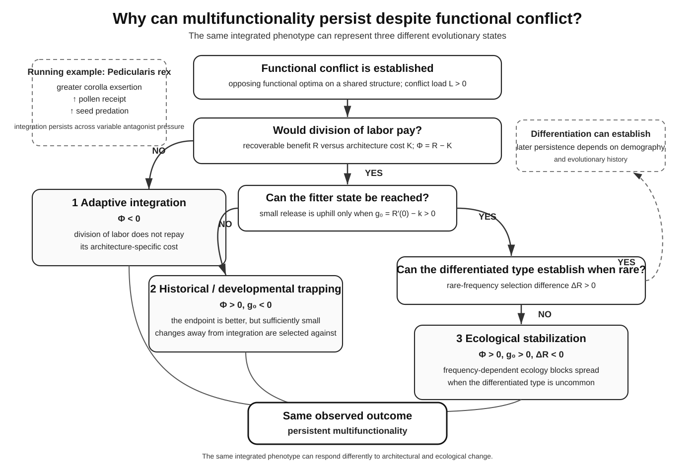
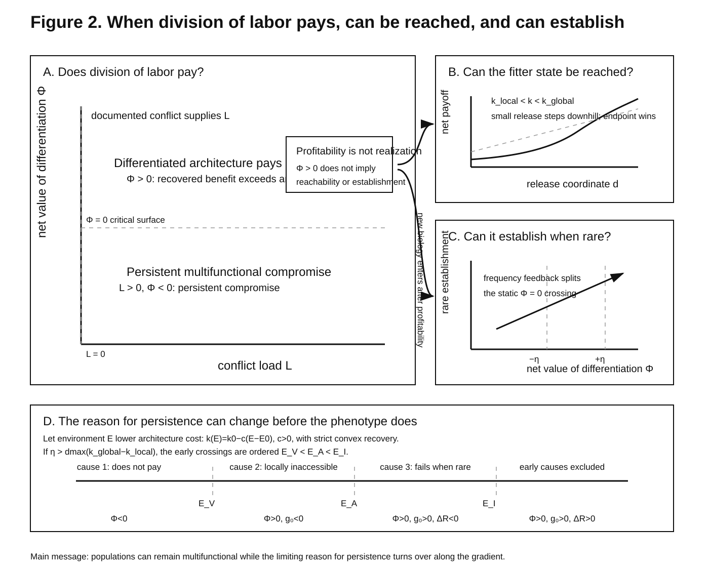

# SLK — Multifunctional Structures Can Persist While Barriers to Division of Labor Change

SLK asks a biological question: **when does functional conflict lead to division of labor, and when does a multifunctional structure persist instead?**

The project draws on several linked theory modules, but the modules are not the subject of the paper. Their roles are:

- [`sch`](https://github.com/zuizui0223/sch): establishes whether opposing functions genuinely conflict on a shared phenotypic coordinate and supplies the conflict quantity `L`.
- [`balance`](https://github.com/zuizui0223/balance): develops diagnostics for the region in which conflict is real but differentiated architecture is not yet favored.
- [`slk`](https://github.com/zuizui0223/slk): asks why documented conflict can remain unresolved by division of labor.
- [`bita`](https://github.com/zuizui0223/bita): separately asks which ecological mechanism generates an observed trait interaction.
- [`payoff`](https://github.com/zuizui0223/payoff): retains broader mathematical extensions used when later population or dynamical questions require them.

## Central question

> **When does functional conflict favor structural division of labor, and when does a multifunctional structure persist instead—and why can the reason for persistence change across ecological contexts?**

For the persistent-integration branch, the central result is a many-to-one mapping: the same visible multifunctional phenotype can persist behind three different evolutionary bottlenecks:

```text
adaptive integration
  Phi < 0
  the focal divided alternative has lower net value

historical / developmental trapping
  Phi > 0, g0 < 0
  a better divided state exists, but the available path is unfavorable

ecological stabilization
  Phi > 0, g0 > 0, Delta_R < 0
  division of labor is favorable and reachable, but fails when rare
```

Architecture economics, evolutionary history, and ecological interactions can therefore maintain the same morphology for different reasons. Environmental change can switch the limiting bottleneck before morphology changes, and the structural or demographic perturbation required for reorganization can shrink during that stasis. The formal comparison is candidate-relative: SLK does not rank structural division against every temporal, plastic, or alternative structural solution.






## Biological predictions

The framework now makes five conditional natural-history predictions.

**1. Conflict strength alone should not rank the tendency toward division of labor.** A system with stronger conflict can remain integrated if little of that conflict is recoverable or if the divided architecture is costly, whereas weaker conflict can be resolved structurally when release is efficient and cheap.

**2. The same integrated morphology can persist behind different evolutionary bottlenecks across environments.** Under the ordered environmental slice, architecture value, local accessibility and rare establishment cross at different conditions. A transect can therefore remain visibly multifunctional while the limiting process shifts from negative divided-state value, to path inaccessibility, to rare-establishment failure.

**3. Historical trapping and ecological stabilization predict different geographic mosaics.** Strict convex recovery creates architecture-path hysteresis: forward and reverse environmental change can retain different architectures even when frequency dependence is absent. Positive frequency dependence instead creates resident-frequency priority effects and alternative locally stable architectures; negative frequency dependence predicts stable coexistence or mixed zones.

**4. Structural novelty and demographic support trade off along one escape frontier.** Under the canonical positive-frequency extension, `p_escape(d)=1/2-[dmax/(2eta)][R(d)/d-k]` under a release-proportional feedback extension that vanishes at `d=0`. The structural threshold `d_J` is the `p=1/2` slice and the endpoint frequency threshold `p_C` is the `d=dmax` slice. Larger favorable structural changes therefore require less initial abundance, while clustering, immigration, or repeated origin can compensate for more modest novelty; environmental change can move the whole frontier before morphology changes.

**5. Partial division can change the ecological prospects of further specialization.** All integrated-versus-variant fitness comparisons may be identical while an established partially differentiated type either resists further rare specialization or permits a relay or direct two-step completion. In the registered symmetric mismatch witness, an initial partial degree `d=1/7` permits rare full division only above a **model-specific** mismatch exponent `q=3.985803...`; below it, further intermediate residents or sufficient founding frequency may be needed. The numerical boundary is not an observed or universal evolutionary threshold. In a finite Moran population, this sharp deterministic threshold becomes a continuous **fixation-probability contrast**: under the specified N=100, beta=0.1 exponential-fitness witness, one completed specialist fixes with probability **2.79%** at q=1 (despite a negative rare-growth margin) versus **3.85%** at q=4; neutral fixation is 1%. This is a model result, not a natural fixation estimate or a claim of novel stochastic evolutionary theory. **Finite-time history also changes:** in a mutation-limited three-architecture model with S→P→D adjacency, symmetric per-edge mutation opportunities, N=100 and β=1, the scaled mean first time to completed division falls from **μT=76.87** at q=1 to **42.57** at q=4; completion by a normalized ecological window μt=40 rises from **28.1% to 59.1%**. Yet asymptotic architecture occupancy remains unchanged under symmetric mutation opportunities. This numerical contrast is model-specific, and the general stationary-versus-transient distinction is existing origin-fixation theory (Sella & Hirsh 2005; McCandlish 2011, DOI 10.1111/j.1558-5646.2011.01236.x). It does not identify any actual ecological window or natural mutation supply; details are in `theory/PARTIAL_DIVISION_RESIDENT_STABILITY_V1.md`.

**A new time-limited ecological interpretation:** at the same scaled opportunity horizon `μt=40`, q=1 leaves **40.9%** of initially integrated replicate lineages unfinished at partial division, versus **10.0%** at q=4, while the fraction still integrated is approximately **31% in both**. If the interaction environment ends at an independent constant hazard `λ`, then without a direct S→D mutation route, the ratio of completed-first-arrival lineages to partial-but-unfinished lineages at environmental turnover is exactly `μρ_(D|P)/λ`. This conditional result links excess intermediate morphologies to **slow progression relative to partner turnover**, not necessarily an adaptive optimum at intermediate differentiation. Changing the mutation graph, turnover process, or ecological payoff rules changes the conclusion. It is a theoretical prediction, not a measured natural proportion.

The strongest original SLK prediction is the **candidate-specific turnover of the first failing bottleneck** and a shifting structure–frequency escape frontier before completed division appears. An additional biological implication is that *partial division changes the ecology faced by later variants*: under two explicitly different mismatch structures, every integrated-versus-divided assay is identical while established partial differentiation either resists onward specialization or enables a chain toward complete division. This is a conditional mechanism already derived in the supporting theory, not a general new theorem about stable specialization and not a verified trajectory in nature. See `theory/PARTIAL_DIVISION_RESIDENT_STABILITY_V1.md`.

## Running biological example

**Wurmbea biological continuation (14 November 2026):** [Female capacity and reproductive return](docs/SLK_ANTO_WURMBEA_REPRODUCTIVE_RETURN_V2_20261114.md) separates sex re-expression from subsequent seed, germination and offspring survival. In a distinct published 2006 experiment, a descriptive female/fruiting-male index through the second growing season is **2.750 under open pollination versus 1.327 under hand crossing**. These are ratios of products of reported treatment means, not lifetime fitness or a causal effect of switching sex. Source means, stage definitions and reproducible calculations are retained; the earlier 1999 author attribution and individual-round-trip wording are corrected.

**Wurmbea ecological gate continuation (15 November 2026):** [Primary-source ecological comparison](docs/SLK_ANTO_WURMBEA_ECOLOGICAL_GATE_CONTEXT_V3_20261115.md) places the 1999/2006/2012 sex-expression and offspring results alongside independent eastern and western studies of moisture, sex-specific allocation, pollinator routes, selfing and seed maturation. In the 12-population western gradient, female-function suppression in cosexual plants under aridity was **not** supported as the simple origin explanation; separate reproductive bottlenecks remain plausible. This is a source-qualified cross-study biological synthesis, **not** a same-cohort meta-analysis, direct SLK fitness-gate estimate or causal demonstration of dioecy origin. The flagship manuscript and main branch remain unchanged.

**Wurmbea observed visitation-versus-seed reversal (15 November 2026):** [Original-source quantitative note](docs/SLK_ANTO_WURMBEA_VISITATION_VS_SEED_REAL_STAGE_DECOUPLING_V3_20261115.md) records that at sympatric western *W. dioica* ssp. *alba* sites, cosexual flowers received **7.29×** as many fly visits per flower as females (from original group means), while females had **3.43–5.00×** the reported seed-to-ovule ratio range. The original study found no significant female-vs-cosexual difference in stigma pollen deposition or a significant hand-cross supplement effect; resource limitation remained plausible. Different flowering months, populations and plant samples prohibit causal mediation, per-visit female fitness, or an SLK evolutionary gate estimate. Published source receipt, standard-library recomputation and seven regression tests are maintained only in this Draft branch.

**Wurmbea scale and evolutionary-direction check (15 November 2026):** [Original-source ecology-to-phylogeny synthesis](docs/SLK_WURMBEA_FLORAL_CONFLICT_EVOLUTION_DIRECTION_V4_20261115.md) places a flower-size-adjusted **intrafloral pollen/fruit allocation compromise** (Jones & Burd 2001) beside independent reported gender lability (Ramsey & Vaughton 2001), Wurmbea plastid ancestry **not securely polarized** (Case et al. 2008, 5–8 minimum parsimony changes across alternative trees), and an independent **2,145-species / 40-genus** macroevolutionary analysis finding no universal direction toward dioecy (Goldberg et al. 2017). Western *W. dioica* ssp. *alba* remains an accepted name at Kew, but genomics projects question whether this complex belongs within eastern *W. dioica*; treat east/west as separate study/taxon blocks. All are published findings, not SLK-fitted origin rates or fitness. Latest checks in the empirical Draft branch only.

**Independent organismal manipulation of temporal sexual conflict (15 November 2026):** [Cyananthus delavayi original-study synthesis](docs/SLK_CYANANTHUS_SEXUAL_PHASE_CONFLICT_EMPIRICAL_V1_20261115.md) contrasts 2015 controlled pollen removal and throat-hair manipulation, a 2017 same-flower single-visit stigma-pollen-to-seed experiment (147 flowers), and a 2021 field manipulation showing **earlier pollen removal can recover hermaphrodite maternal seed success to the level of females**, while reduced removal prolongs the male phase at the female phase's expense. The five-population ~2-fold female seed advantage is a **published study result, not SLK's estimate**. The studies overlap in organism and investigators and do **not** estimate historical origins, genotypic invasion, module-cost `K`, or SLK `Phi/g0/Delta_R`. They illustrate an ecological opportunity-dependent rescue **within the existing multifunctional flower**, not a universal requirement for permanent structural division. Added primary-source receipt and CI guard in this empirical Draft only.

**Cyananthus two ecological time bottlenecks (15 November 2026):** [Original 2011 closure-table reanalysis and 2015/2021 phase-switch synthesis](docs/SLK_CYANANTHUS_TWO_TEMPORAL_BOTTLENECKS_ECOLOGY_V2_20261115.md) separates failure to **exit the male phase** when pollen is not removed from premature **termination of the female phase** after pollen arrives. In Niu et al. (2011), the original 3×2 published table gives female-flower closure in **20/52, 40/63, 41/48** usable flowers after 10, 20, 30 pollen grains; the recomputed Pearson chi-square **23.45108558** matches the original 23.451. Originally **216** female flowers were treated, but only **163** had the required paired closure/fertility information. A paired ring manipulation under **sufficient** pollen found no significant seed benefit to blocking closure. Even under every possible assignment of missing closure outcomes, the original 30-grain female treatment retains a higher closure fraction than 10 grains. At **matched 20-grain cross-pollen dose**, female-only flowers close more often than hermaphroditic flowers (**40/63 vs 7/26** usable; original χ²=9.876, p=.002); this ordering likewise survives extreme missing-outcome assignments, but sex morph was not randomized. **Sex division does not automatically eliminate the female-side receptive-closure constraint.** The authors did **not** establish donor manipulation, historical origin or a low-pollen counterfactual seed effect. This is an organismal, source-audited insight, not an estimated SLK `Phi/g0/Delta_R`; 2011 and later studies are not one within-flower factorial experiment. Linked code, frozen results, 12 regression tests and CI remain on the empirical Draft branch only.

**Three real reproductive-conflict routes and 2025 novelty boundary (15 November 2026):** [Biology-first source comparison](docs/SLK_NATURAL_CONFLICT_ROUTES_AND_PRIOR_ART_V1_20261115.md) links protandrous *Cyananthus* (slow pollen removal prolongs male phase and shortens maternal phase), protogynous *Pulsatilla alpina* (male-only flowers open early to avoid the female-first delay; direct female-pistil selection β=+0.72 versus male β=−0.51), and wind-pollinated *Mercurialis annua* (male allocation increases selfing; disruptive selection in medium/large plants is significant under **assumed** δ=1, not δ=0; the diploid experiment's actual δ was **not measured**). Published 2025 *Pulsatilla* Am Nat Table 1 reconstructs annual **M→H 5/7 and 2/6, H→M 2/26 and 1/41** from the same tagged cohort; this is seasonal functional expression, not genetic reacquisition. All 2022 Solalex *Pulsatilla* studies are substantially **same-population** prior art, including an existing 2025 *Current Biology* male/bisexual fitness landscape; SLK does not claim first discovery of those peaks or novel natural evolutionary origin. Source receipts, original-table reconstruction, tests and GitHub Actions are confined to the biological Draft branch.

**Sagittaria segregating architectures and habitat-conditioned persistence (15 November 2026):** [Original-source organismal evidence note](docs/SLK_SAGITTARIA_GENETIC_ACCESS_ECOLOGICAL_STABILITY_V1_20261115.md) documents crosses between monoecious and dioecious *Sagittaria latifolia* (Dorken & Barrett 2004) yielding **676 F2/backcross offspring in eight families with male 48%, monoecious 26%, female 26%** (the published two-locus-model pooled G p=.63). Since printed fractions are rounded, the monoecious count is only identified as **173–179**, not an invented exact headcount. In a within-genotype fertilizer manipulation, 10 of 23 male genotypes made both sex flowers in high fertilizer whereas 21 of 23 were male-only in low fertilizer; **at least eight matched genotypes necessarily changed expression** by the pigeonhole principle, independently of unknown labels. Separate 2003 reciprocal transplant evidence shows monoecious and dioecious origins survive better in their respective disturbance/open vs shaded/permanent wetland habitat; later independent mating arrays show prolonged male pollen presentation and short-term siring gains, and a 2012 412-plant experiment distinguishes female biomass and male nitrogen costs. **Genetic combinations achievable ≠ beneficial in every environment ≠ rare-type invasion.** Distinct cohorts and allelic recombination do not estimate new mutation, `Phi/g0/Delta_R` or historical directional transitions. Original study-source receipt, transparent printed-proportion bounds, 11 tests and dedicated CI are kept solely in Draft.

**Sagittaria realized partner-routing audit (15 November 2026):** [Original 2006/2022/2023 mating-path evidence](docs/SLK_SAGITTARIA_PARTNER_ROUTING_VS_RARE_ESTABLISHMENT_V2_20261115.md) shows a **floral-display × sexual-system rank reversal in between-plant pollinator delivery sequences** (Vamosi et al. 2006, 20 four-plant trials / 3,143 flower visits / 872 trips, interaction p=.041), but this endpoint is **not genetic paternity or lifetime fitness**. In natural populations, clone-size-adjusted **male-function Bateman slopes are positive under both monoecy (β=1.02±.35) and dioecy (β=.95±.15)** (Kwok & Dorken 2022); without size adjustment, the reported male-minus-female differences reverse sign. In an independent 2013 monoecious phenology cohort, **calculated temporal pollen-transfer opportunities did not detectably predict actual paternal success** (Kwok et al. 2023, p=.24; date p=.92), suggesting an unresolved spatial/partner-route mechanism rather than proof that timing has no effect. Older original population-marker data show selfing .41 vs .11 in six populations per sexual system, with similarly high estimated inbreeding depression (.83/.84), not a single-cohort lifetime fitness cost. **A rare male/female combination in two-locus dioecy cannot be treated as one rare mutant phenotype**; no actual SLK `Phi/g0/Delta_R` or genotype-frequency invasion was estimated. Source JSON, deterministic checks, 10 tests and a dedicated GitHub workflow remain exclusively in Draft.

**Mercurialis ploidy and invasion evidence firewall (15 November 2026):** [Primary-source ecology × genetics note](docs/SLK_MERCURIALIS_PLOIDY_GENETIC_SUPPLY_AND_RARE_ESTABLISHMENT_V1_20261115.md) separates Eppley & Pannell's 2007 wind-mating arrays (**diploid males × allohexaploid hermaphrodites**, only **0 or 50% males** in the 2004 factorial) from Gerchen et al.'s 2026 diploid **XX male-free experimental-evolution/QTL** study and Nguyen & Pannell's 2026 geographical common garden of **diploid wild-derived dioecious** plants. The original 2007 male-presence contrast raises outcrossing **42.5%→76.3% (+33.8 percentage points, p=.0042)** but does **not** directly test rare-male invasion; the density threshold is an original-author model prediction. Diploid XX evolution shows genetic antagonistic and function-specific QTL effects, but **no one-gene pleiotropy established**. In wild-derived 2026 plants, range-margin **incidence**, not conditional **degree**, of leaky opposite-sex function rises. The observed ecological, genetic and geographic endpoints cannot be pooled into a same-ploidy lifetime-invasion coefficient, nor are established density-dependent male-invasion models novel SLK theory. Source receipt, recalculator, 11 regression tests and dedicated CI remain exclusively on the biological Draft branch.

**Mercurialis partner-composition and next-generation sex-ratio test (15 November 2026):** [Original 2008/2012/2024 study-level biological synthesis](docs/SLK_MERCURIALIS_DENSITY_TRIOECY_PARTNER_COMPOSITION_V2_20261115.md) reproduces **8 paired-origin androdioecious density arrays** (Dorken & Pannell 2008, offspring male fraction **.2925 low vs .40375 high**, parent-adjusted high-minus-low +.105, rounded-source paired t=2.63 reproducing original), versus **20 trioecious plots / 6,076 offspring** with females present at every density (Perry et al. 2012, male-present plot means **.316 low vs .326 high**, original GLM density p>.5). In the latter, females allocated **1.419×** the seed biomass fraction of hermaphrodites, yet original plotted sex ratios guarantee **17/20 plots with female-frequency decline**, two with increase, one rounding-ambiguous. **Within the actual 2012 factorial, replacing some hermaphrodites with males while keeping density and female frequency fixed produced opposite seed-biomass allocation changes** in females (**.067 no males → .061 with males**) and monoecious hermaphrodites (**.042 → .047**), original male-presence×morph **F(1,445)=6.3, p<.05**; this is NOT a female-presence intervention, paternity or a frequency-change mechanism; 0–4% male progeny in male-free treatments indicate pollen infiltration. This does **not** causally estimate the buffering effect of females: different populations/experimental years/densities. Nguyen et al. (2024) documented **36 trioecious of 109 Iberian populations**, with no general female-frequency density association (p=.620), and inferred cytoplasmic male sterility + linked restorer inheritance, **not molecularly confirmed** or demonstrated infinite equilibrium. **Source QA:** original 2008 table's eight low-density offspring sample sizes sum **7,293** but printed low-density total is **7,239**; both preserved without inventing correction. Raw population CSVs inaccessible; new work is original-publication table transcription, plot/source-unit arithmetic, rounding bounds and regression tests, *not* rare-genotype invasion or a newly found frequency-dependence mechanism. The evidence is held in Draft #121, not the flagship.

**Actual published 2012 Mercurialis plot reanalysis (15 November 2026):** [New ecological source-level result](docs/SLK_MERCURIALIS_2012_ACTUAL_PLOT_POLLEN_EFFORT_VS_OFFSPRING_V3_20261115.md) computes a full **C(10,5)=252** label-enumeration reference distribution on the *same 10 male-present experimental plots* of Perry et al. (2012), separated into 5 low/5 high density. The original Table 2 relative male-function biomass investment **p_h=π_hermaphrodite/π_male** is **.188 low vs .106 high**, all five high values below all five low values; exploratory two-sided plot-label permutation **p=2/252=.00794**. In contrast, **next-generation male morph fraction** is **.316 low vs .326 high**, permutation **p=210/252=.833**; the source's original GLM likewise reported density **p>.50**. Source two-decimal rounding bounds preserve **p_h high−low ∈ [−.092,−.072]**, but only bound the male-morph frequency difference to **[0,.020]**. This is a genuine new reanalysis of **published plot means**, not new raw data, independent natural origins, demonstrated absence of fitness response, paternal genotypes, or SLK invasion. p_h reflects *relative pollen biomass allocation*, NOT actual male siring; male progeny morph is an inheritance-dependent child phenotype. Sample size is **10 plots, not 6,076 independent treatments**, tests are exploratory rather than preregistered. Figshare 2024 population files were not accessible through current tools. Frozen result, 10 source tests and CI added to empirical Draft #121 only; main and flagship unchanged.

**CORRECTED original 2012 Mercurialis reproductive-allocation result (15 November 2026):** [Audited source plot table and strict measurement note](docs/SLK_MERCURIALIS_SEED_ADVANTAGE_VERSUS_GENETIC_TRANSMISSION_V4_20261115.md) finds that **19/20** authentic experimental plots have a larger **female fraction of aboveground biomass allocated to seeds** than the corresponding hermaphrodites, but **17/20** show a decline in the female phenotype frequency among sampled next-generation offspring. **CRITICAL primary Methods correction**: source `σ_h`/`σ_f` are seed dry biomass divided by aboveground biomass, not absolute seed number, offspring viability or parentage. The original Table 2 `o_h=σ_h/σ_f` therefore measures **relative maternal reproductive-effort shares**, not the `g` of viable seed counts in genetic invasion models. Reciprocal allocation-share ratios can be described as **1 plot with no female advantage, 15 with 1–2× higher fractional investment and 4 above 2×**, but **NONE of these bins estimates whether CMS or nuclear sterility can invade**. Nguyen & Pannell (online 2024, *Heredity* 2025 DOI 10.1038/s41437-024-00729-7) had **already** distinguished rare CMS invasion from established trioecy maintenance with sons that cannot maternally transmit CMS, and discussed classic viable seed count requirements `g>1` for cytoplasmic versus `g>2` for nuclear male sterility **only under special fully outcrossing ancestral conditions**. Laugier et al. (2025 *Am Nat*) provide independent 11-generation experimental cytotype evolution in **animal** *Physa acuta*, not plant trioecy. Source JSON, calculation code, frozen result, source tests and CI explicitly forbid using 2012 allocation share as model fecundity or SLK `Phi/g0/Delta_R`. No raw CMS genotypes, individual pedigrees or genetic invasion are claimed. Kept on biological Draft #121; main and flagship unchanged.

**Within-paper 2024 Mercurialis spatial reproductive-stage validation (15 November 2026):** [Actual pollen-distance field-assembly and seed-stage source audit](docs/SLK_MERCURIALIS_2024_SPATIAL_POLLINATION_STAGE_FILTER_V5_20261115.md) re-expresses the *published* Nguyen et al. (2024 AJB DOI 10.1002/ajb2.16429) LMM at its **0.5m and 1.5m experimental ring positions** (3 assemblies ×28 originally planted, 71 included in Table 2). The measured response was **female flowers failing to develop fruit / total female flowers**—a source-inferred **pollen limitation proxy, NOT directly counted stigma pollen**. Reported female-minus-monoecious-hermaphrodite additive offset **+.053** (95%CI .006–.100, p=.029), distance slope **+.084 per meter** (95%CI .047–.121, p<.001), and nondetected sex×distance interaction (p=.80) imply source-fitted **unfruiting fractions .194→.278 for hermaphrodites and .247→.331 for females** as distance grows 0.5→1.5m. No source-supported distance/sex **seed biomass** effect was detected (p=.17/.58); these are **different reproductive stages**, not proof of compensation or a complete fitness effect. Independent 2024 common garden measures male floral effort **11.7×** hermaphrodite (95%CI 11.2–12.9), **not paternity**. **Primary publication QA:** its seed-count-per-biomass narrative reports `t=2.91, df=213, p=.097` while Table 1 CI `[-.76,9.46]` crosses zero; this is inconsistent and has **not been silently repaired or promoted**. Author-simulated fertility-restorer cost **ρ=.15–.40** to match field morph frequencies is **not empirically measured**. The source receipt, deterministic fitted arithmetic, frozen JSON, new tests and dedicated CI remain in the biological **Draft** only; no new SLK `Phi/g0/Delta_R` or genetic invasion claims.

**Direct mate-loss response in *diploid* Mercurialis (2021 original experiment, 15 November 2026 audit):** [Organismal source note and inference boundary](docs/SLK_MERCURIALIS_2021_MATE_LOSS_FUNCTIONAL_REEXPRESSION_V1_20261115.md) audits Cossard & Pannell (2021, J Evol Biol DOI **10.1111/jeb.13720**), which **experimentally randomized plants from a pooled 35-deme seed source across 3 all-female versus 3 1:1 male/female gardens**. In **272 scored XX females**, male-flower dry-biomass allocation **MRE increased 2.33× without male mating partners** (published p=.01), whereas leaky-female incidence trend **p=.058** and female reproductive allocation **p=.19** were not significant. Those are **six manipulated population contexts**, not 272 independent experiments or identical clones repeated between contexts; source pot-nesting counts imply **80/272 (29.4%) females shared their pot with another scored female**. The 5% control-incidence category derives from a 95th-percentile MRE threshold **by definition**, not a natural prevalence estimate. Source authors did not establish induced pollen fertility, genetically confirmed selfed offspring, fitness benefits of plasticity, the perceptual cue, or island adaptation. **Different cytotype:** 2024 *hexaploid* trioecious females often retain **visually male-like but sterile flowers**, while 2021 diploid XX females increase male-flower construction in male-free plots: observed organ form, mating function and genetic capability are different variables, **NOT a linked evolutionary restoration of deleted genes**. The source receipt, source-only count audit, frozen output, tests and CI are on empirical Draft #121 only, not flagship/main.

The manuscript uses *Pedicularis rex* as a literature-based running example. Existing work documents opposing pollinator- and seed-predator-mediated selection on floral exsertion and experimentally supports a defensive role of water held by cup-like bracts. That establishes the biological motivation—real conflict in a multifunctional structure—but it does **not** yet identify why integration persists.

The important biological point is that the balance of this conflict already varies geographically: seed-predator effects change strongly among populations while the pollinator side is more consistent. The same integrated floral architecture can therefore occupy different selective environments across the species' range.

No new *P. rex* biological result is claimed by this repository.

## Floral ecological extension — structural division is not the only reproductive route

Across three paired large/small-flowered lineages of *Solanum* section *Androceras*, the single pollinating anther's share of pollen falls from **50–67%** to **39–41%**: differentiation weakens but is not erased (Vallejo-Marín et al. 2014). The small-flowered taxa also dispense pollen faster under simulated buzzing (Kemp and Vallejo-Marín 2021). Manual self-pollination worked in both large- and small-flowered taxa, but autonomous seed production occurred in two small-flowered taxa and none of their three large-flowered comparators; the remaining small-flowered result was inconclusive because it failed to fruit even with hand pollination (Rubini Pisano et al. 2026, DOI 10.1093/aob/mcag186). This distinguishes self-compatible reproduction from the geometry or other mechanisms that permit pollen to reach the stigma without a visitor. Crucially, phenotypic covariation between the two anther classes and between corolla and sexual organs weakens, while selected anther–stigma associations strengthen. This suggests **functional reallocation of floral coordination**, not a general loss of all integration. The study documents seed-autonomy capacity and trait covariance, not wild selfing rates, selection causing the morphological transition, or an SLK three-gate turnover. Pollen and seed discounting, as well as inbreeding depression, still matter to selfing's full fitness value (Porcher and Lande 2005, DOI 10.1111/j.1420-9101.2005.00905.x).

Separate *Solanum* (2022), *Chamaecrista* (2025) and *Bredia* (2026) experiments demonstrate that floral organs can share mechanical transport and grip functions even when their pollen-handling roles differ. Enhanced vibration, pollen deposition on an artificial bee, and stable buzzing are different endpoints from realized male or female reproductive fitness. An accessible flower retaining mechanical support but reducing anther differentiation is therefore a legitimate evolutionary candidate. Its fitness and historical accessibility remain unmeasured; supporting filaments do not by themselves explain retention of differentiated pollen-producing anthers. See `docs/FLORAL_PARTNER_FUNCTION_SWITCH_V1.md`, `docs/FLORAL_SHARED_MECHANICS_EVIDENCE_V1.md`, and `theory/FLORAL_SCAFFOLD_BYPASS_V1.md`.

**Where pollen goes matters, not just how much disappears.** A 2025 controlled *Bombus terrestris* study found different pollen-loss routes for heterantherous *Solanum rostratum* versus coned-anther *S. dulcamara*: respectively about 63% versus 19% of removed pollen fell to the ground, while about 28% versus 66% entered bee corbiculae. Only ~1% of removed pollen was deposited on four subsequent stigmas in either species, without a statistically detected PTE difference (Vasquez-Castro et al. 2025, DOI 10.26786/1920-7603(2025)836). The small two-species trial does **not** establish equivalence, a cause-specific architecture effect, genetic paternity, or an observed evolutionary transition. It shows that similar measured pollen-transfer endpoints can hide very different bee reward and pollen-waste pathways; see `docs/FLORAL_SHARED_MECHANICS_EVIDENCE_V1.md` for the quantitative primary-source audit.

**Pollen receipt need not predict seed maturation, even within one species.** Under controlled *S. rostratum* bee visits, larger abdomens relative to anther–stigma separation predicted more stigma pollen, whereas smaller relative abdomens were associated with more seeds per fruit; fruit set had no significant association (Solís-Montero and Vallejo-Marín 2017, DOI 10.1002/ece3.2897). The experiment did not distinguish excess-pollen effects from geitonogamous pollen or inbreeding depression. Together, the 2017 and 2025 studies make floral division a question about distinct ecological outcomes, not a one-dimensional quantity of pollen moved.

## Independent empirical macro bridge — pollen limitation is context dependent

We added an **original, source-verified synthesis of published experiments**, not new field measurements and not a direct test of SLK's three specialization gates. The public GloPL dataset (Bennett et al. 2018; DOI [10.5061/dryad.dt437](https://doi.org/10.5061/dryad.dt437)) contains 2,969 pollen-limitation experiments. In a deliberately matched subset of flower-level fruit-set pollen-supplementation experiments, **53 species / 58 within-study repeated-site or repeated-year groups** can be compared; **31/58** groups differ by at least 0.5 in the log pollen-supplementation response ratio. This documents substantial heterogeneity in reproductive context within the same species, but it does not show the same genotype or anther architecture persisted or identify why pollen limitation changed.

We then independently matched the original Razanajatovo et al. (2016) global breeding-system indices (DOI [10.1038/ncomms13313](https://doi.org/10.1038/ncomms13313)) by exact plant binomials: **429 species** overlap GloPL overall, **81** overlap the strict fruit-set protocol, **68** have self-compatibility (SC) fruit-set indices and **56** have autofertility (AF) indices. Unadjusted rank associations with species-level pollen limitation were **SC rho=-0.282, p=0.0218** and **AF rho=-0.073, p=0.5944**. However, on the **same 54 species** their differences were not supported (paired bootstrap interval for rho_SC-rho_AF: **[-0.466, +0.069]**). Emasculation-exclusion and family aggregation further weakened the SC association. Only **8** of the strictly multi-context species had measured AF, so **AF buffering environmental fluctuation is unresolved**, not demonstrated.

These results are kept in independent, reproducible ecological companion notes rather than promoted to evolutionary maintenance evidence: `docs/SLK_GLOPL_CONTEXT_PILOT_V1.md` and `docs/SLK_GLOPL_BREEDING_MACRO_PILOT_V1.md`. Scripts and source-verified GitHub Actions include `scripts/analyze_glopl_context_variation.py`, `scripts/audit_glopl_breeding_overlap.py`, and `scripts/analyze_glopl_autofertility.py`. Source raw files are not redistributed. The ecological claim ceiling for the flagship remains unchanged.

## What the theory contributes

The mathematical machinery supports the biological theory rather than replacing it. The main contributions are:

1. a common fitness comparison `Phi=R-K` that separates conflict strength from the net value of division of labor;
2. a demonstration that positive endpoint value can coexist with a local accessibility barrier under convex recovery;
3. a population-level establishment test showing that frequency-dependent ecology can reverse the endpoint verdict when a differentiated type is rare;
4. three early bottlenecks that can maintain persistent integration—architecture value, evolutionary path, and ecological establishment—with adaptive integration, historical trapping, and ecological stabilization as their biological interpretations;
5. the comparative prediction that stronger conflict need not imply more differentiation;
6. the ecological prediction that profitability and rare establishment can be displaced along environmental gradients;
7. the prediction that ecological context can change the evolutionary resolution of conflict, including cases in which the same phenotype persists for different reasons across environments;
8. the prediction that phenotypic stasis can conceal a moving architecture-frequency escape frontier: structural novelty and demographic support can compensate for one another, and the viable set of combinations can expand before morphology changes.

Finite-population fixation and weak-mutation occupancy remain valid **downstream extensions**. Under the specified symmetric rare-mutation exponential-Moran process, reciprocal fixation ordering and stationary monomorphic occupancy re-align at `Phi=0`. Those process results are retained because they delimit stronger evolutionary claims, not because they are a fourth explanation for persistent multifunctionality.

## Prior-art boundary

SLK does **not** claim a first theory of modularity, specialization, division of labor, pleiotropy, mutational accessibility, invasion fitness, fixation, or weak-mutation dynamics. Existing specialization theory already shows that whether division of labor is favored depends on performance curvature, trade-off structure, positional effects, synergy, and fitness mapping. Gene duplication, sexual dimorphism, and floral heteranthery provide established biological routes by which shared functions can become decoupled.

The narrower contribution is to make **the evolutionary resolution of documented functional conflict** the object to be explained: why some systems divide functions structurally, others retain integration, and why the selective state maintaining the same integrated architecture can change with environment before morphology changes.

## Biological interpretation of architecture cost

`K` is the net fitness debit of maintaining the divided architecture relative to the matched integrated comparison. Biologically, it can include additional developmental, regulatory, structural, or maintenance burdens, provided they are not already counted as lost recovered performance. Its role is simple: even severe functional conflict need not favor division of labor when the architecture that resolves it is too expensive.

## Pedicularis rex as a prospective biological test

*Pedicularis rex* remains the focal prospective system because the functional conflict is already documented: greater floral exposure improves pollen receipt but also increases seed predation, while water-filled bracts reduce seed-predator damage. The unresolved biological question is whether populations exposed to different antagonist and density regimes remain integrated because integration is adaptive, because structural release is historically constrained, or because a divided alternative would be ecologically disadvantaged when rare.

No new *P. rex* biological result is claimed here. The field programme belongs to a separate empirical companion; operational permission, outreach, access, and field logistics are not part of the flagship argument.

## Publication architecture outside the flagship

The source repositories are no longer treated as one-paper-per-repository. Their current roles are:

- **SCH — active full paper:** causal identification of functional conflict; `multifunctionality != conflict`; contextual-versus-pure-function optimum promotion gate; empirical crossed-design programme.
- **BITA — active full paper:** ecological mechanism identification after trait interaction; `interaction != mechanism`; partial-identification workflow and route synthesis.
- **PAYOFF-B — active short Note:** exact anti-phase two-patch/two-season temporal solution and unique finite migration optimum.
- **BALANCE — DOI technical module / dormant paper branch:** middle-world certification, direct worldline identification, reserve/depth/topology and persistence/hysteresis methods.
- **PAYOFF-A / spatial / topology — DOI technical modules / dormant paper branches:** continuous architecture and branching, general spatial spectral transport, and edgewise/topological extensions.

These modules may be cited by SLK without being promoted to independent manuscripts. Dormant branches can be reactivated only when they acquire a genuinely independent theorem family or decisive empirical anchor. See `docs/PAPER_ROADMAP.md`.

## Canonical reader path

For the flagship argument, the canonical path is deliberately short:

1. `manuscript/SLK_MANUSCRIPT_AMNAT_V4.md` — current journal-facing manuscript.
2. `figures/FIG1_LOGIC_DIAGRAM.svg` — one persistent phenotype mapped to distinct architecture, path, and establishment bottlenecks.
3. `figures/FIG2_PHASE_MAP.svg` — natural examples showing structural partitioning, temporal partitioning, geographic variation, frequency dependence, and ecological re-coupling.
4. `figures/FIG3_EMPIRICAL_LADDER.svg` — hidden erosion of evolutionary resistance, path hysteresis, clustered establishment, and environmental turnover of the bottleneck maintaining integration.
5. `docs/EMPIRICAL_BRIDGE_EVIDENCE_V1.md` — cross-system evidence ledger showing which real systems inform architecture value, developmental access, and rare establishment, while preserving the boundary between analogues and direct SLK gate estimates.
6. `theory/UNIFIED_THRESHOLD_ATLAS_V1.md` — full supporting mathematics, including witness families, environmental predictions, and downstream process results.
7. `theory/SLK_CORE_THEORY_V1.md` — minimal mathematical spine.
8. `docs/THEOREM_CLAIM_LEDGER_V1.md` — theorem and derived-consequence status.
9. `docs/INV1_EXECUTABLE_VALIDATION_V1.md` — independent process validation.
10. `docs/PRIOR_ART_BOUNDARY_V1.md` — novelty boundary.
11. `docs/REPOSITORY_SCOPE_BOUNDARY_V1.md` — theory-core versus empirical-companion boundary.

Pedicularis execution documents are retained for provenance during migration but are not part of the canonical reader path.

## Current status

```text
FLAGSHIP_MANUSCRIPT_V4_ACTIVE
GENERAL_PHI_EQUALS_R_MINUS_K_SPINE_DEFINED
UNIFIED_CRITICAL_SURFACE_ATLAS_REGISTERED
ONE_FAMILY_WITNESS_SYSTEM_REGISTERED
FIXATION_OCCUPANCY_INVARIANT_REGISTERED
ECOLOGICAL_THRESHOLD_DISPLACEMENT_REGISTERED
ENVIRONMENTAL_PERSISTENCE_BARRIER_TURNOVER_REGISTERED
ARCHITECTURE_PATH_HYSTERESIS_REGISTERED
HIDDEN_RESISTANCE_EROSION_REGISTERED
FREQUENCY_DEPENDENT_SPATIAL_OUTCOMES_REGISTERED
NATURAL_SYSTEM_RESOLUTION_SYNTHESIS_REGISTERED
EMPIRICAL_BRIDGE_EVIDENCE_LEDGER_REGISTERED
PEDICULARIS_PROSPECTIVE_ANCHOR_REGISTERED
PEDICULARIS_REAL_DATA_G1_G5_RECEIPTS_ZERO
PEDICULARIS_OPERATIONS_COMPANION_BOUNDARY_REGISTERED
PEDICULARIS_OPERATIONS_FLAGSHIP_GROWTH_CI_BLOCKED
PEDICULARIS_OPERATIONS_DELETION_FOR_MIGRATION_ALLOWED
EMPIRICAL_COMPANION_160_FILE_MANIFEST_FROZEN
EMPIRICAL_COMPANION_DESTINATION_VERIFICATION_REQUIRED_BEFORE_PRUNING
AMNAT_LATEST_HEAD_TEST_AND_BUNDLE_CI_PASS
AMNAT_RENDERED_LAYOUT_PREVIOUS_QA_NOT_FROZEN_CURRENT
AMNAT_REVIEWER_ZIP_LATEST_CI_BUILT_TRACKED_RECEIPT_STALE
AMNAT_ZENODO_ARCHIVE_TRACKED_RECEIPT_STALE
AMNAT_PORTAL_READINESS_GATE_REGISTERED
AMNAT_EDITORIAL_MANAGER_UPLOAD_KIT_TRACKED_RECEIPT_STALE
AMNAT_HUMAN_PORTAL_FIELDS_ARCHIVE_AND_REFREEZE_OUTSTANDING
EMPIRICAL_CLAIM_CEILING_UNCHANGED
```

The source branch passed its latest Python 3.11/3.12 and anonymous-bundle CI checks at commit `e09cf67a6154` before this README-only clarification. This does **not** update the frozen local checksum receipts for the reviewer ZIP, Editorial Manager kit, or archive deposit. Build artifacts, deposited archives, and an actual journal submission are separate steps; no journal submission is claimed.

## Journal decision rule

The present flagship target remains **The American Naturalist**. The end-to-end Pedicularis machinery improves credibility and executability but does not itself raise the empirical claim ceiling.

Reassess an **Ecology Letters** submission only after a real same-system G1-G5 receipt exists. The strongest trigger is a sharp biological separation such as:

```text
L > 0
R > 0
Phi < 0
```

or, after one focal G1-G5 context has already closed, a prospectively registered environmental crossing of `Phi = 0`.

SLK does not turn theoretical quantities or prospective protocols into empirical measurements by declaration. Any empirical use of `L`, `R`, `s`, `K`, `Phi`, accessibility, invasion, fixation, or occupancy must retain the identification requirements and uncertainty of the source analysis.
