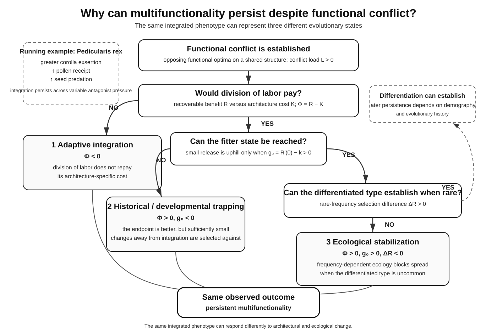
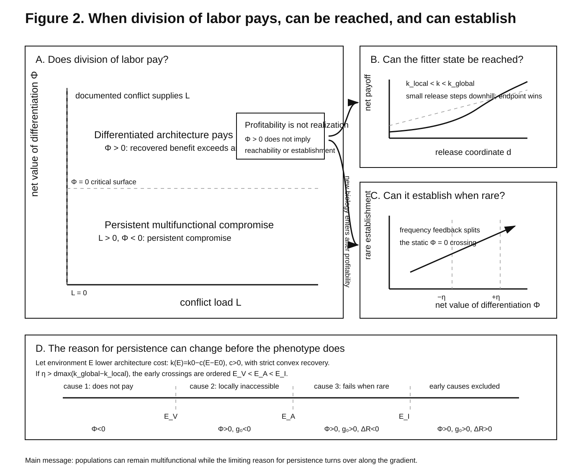

# SLK — Multifunctional Structures Can Persist While Barriers to Division of Labor Change

SLK asks a biological question: **when does functional conflict lead to division of labor, and when does a multifunctional structure persist instead?**

The project draws on several linked theory modules, but the modules are not the subject of the paper. Their roles are:

- [`sch`](https://github.com/zuizui0223/sch): establishes whether opposing functions genuinely conflict on a shared phenotypic coordinate and supplies the conflict quantity `L`.
- [`balance`](https://github.com/zuizui0223/balance): develops diagnostics for the region in which conflict is real but differentiated architecture is not yet favored.
- [`slk`](https://github.com/zuizui0223/slk): asks why documented conflict can remain unresolved by division of labor.
- [`bita`](https://github.com/zuizui0223/bita): separately asks which ecological mechanism generates an observed trait interaction.
- [`payoff`](https://github.com/zuizui0223/payoff): retains broader mathematical extensions used when later population or dynamical questions require them.

## Central question

> **When does functional conflict favor structural division of labor, and when does a multifunctional structure persist instead—and why can the reason for persistence change across ecological contexts?**

For the persistent-integration branch, the central result is a many-to-one mapping: the same visible multifunctional phenotype can persist behind three different evolutionary bottlenecks:

```text
adaptive integration
  Phi < 0
  the focal divided alternative has lower net value

historical / developmental trapping
  Phi > 0, g0 < 0
  a better divided state exists, but the available path is unfavorable

ecological stabilization
  Phi > 0, g0 > 0, Delta_R < 0
  division of labor is favorable and reachable, but fails when rare
```

Architecture economics, evolutionary history, and ecological interactions can therefore maintain the same morphology for different reasons. Environmental change can switch the limiting bottleneck before morphology changes, and the structural or demographic perturbation required for reorganization can shrink during that stasis. The formal comparison is candidate-relative: SLK does not rank structural division against every temporal, plastic, or alternative structural solution.






## Biological predictions

The framework now makes five conditional natural-history predictions.

**1. Conflict strength alone should not rank the tendency toward division of labor.** A system with stronger conflict can remain integrated if little of that conflict is recoverable or if the divided architecture is costly, whereas weaker conflict can be resolved structurally when release is efficient and cheap.

**2. The same integrated morphology can persist behind different evolutionary bottlenecks across environments.** Under the ordered environmental slice, architecture value, local accessibility and rare establishment cross at different conditions. A transect can therefore remain visibly multifunctional while the limiting process shifts from negative divided-state value, to path inaccessibility, to rare-establishment failure.

**3. Historical trapping and ecological stabilization predict different geographic mosaics.** Strict convex recovery creates architecture-path hysteresis: forward and reverse environmental change can retain different architectures even when frequency dependence is absent. Positive frequency dependence instead creates resident-frequency priority effects and alternative locally stable architectures; negative frequency dependence predicts stable coexistence or mixed zones.

**4. Structural novelty and demographic support trade off along one escape frontier.** Under the canonical positive-frequency extension, `p_escape(d)=1/2-[dmax/(2eta)][R(d)/d-k]` under a release-proportional feedback extension that vanishes at `d=0`. The structural threshold `d_J` is the `p=1/2` slice and the endpoint frequency threshold `p_C` is the `d=dmax` slice. Larger favorable structural changes therefore require less initial abundance, while clustering, immigration, or repeated origin can compensate for more modest novelty; environmental change can move the whole frontier before morphology changes.

**5. Partial division can change the ecological prospects of further specialization.** All integrated-versus-variant fitness comparisons may be identical while an established partially differentiated type either resists further rare specialization or permits a relay or direct two-step completion. In the registered symmetric mismatch witness, an initial partial degree `d=1/7` permits rare full division only above a **model-specific** mismatch exponent `q=3.985803...`; below it, further intermediate residents or sufficient founding frequency may be needed. The numerical boundary is not an observed or universal evolutionary threshold. In a finite Moran population, this sharp deterministic threshold becomes a continuous **fixation-probability contrast**: under the specified N=100, beta=0.1 exponential-fitness witness, one completed specialist fixes with probability **2.79%** at q=1 (despite a negative rare-growth margin) versus **3.85%** at q=4; neutral fixation is 1%. This is a model result, not a natural fixation estimate or a claim of novel stochastic evolutionary theory. **Finite-time history also changes:** in a mutation-limited three-architecture model with S→P→D adjacency, symmetric per-edge mutation opportunities, N=100 and β=1, the scaled mean first time to completed division falls from **μT=76.87** at q=1 to **42.57** at q=4; completion by a normalized ecological window μt=40 rises from **28.1% to 59.1%**. Yet asymptotic architecture occupancy remains unchanged under symmetric mutation opportunities. This numerical contrast is model-specific, and the general stationary-versus-transient distinction is existing origin-fixation theory (Sella & Hirsh 2005; McCandlish 2011, DOI 10.1111/j.1558-5646.2011.01236.x). It does not identify any actual ecological window or natural mutation supply; details are in `theory/PARTIAL_DIVISION_RESIDENT_STABILITY_V1.md`.

**A new time-limited ecological interpretation:** at the same scaled opportunity horizon `μt=40`, q=1 leaves **40.9%** of initially integrated replicate lineages unfinished at partial division, versus **10.0%** at q=4, while the fraction still integrated is approximately **31% in both**. If the interaction environment ends at an independent constant hazard `λ`, then without a direct S→D mutation route, the ratio of completed-first-arrival lineages to partial-but-unfinished lineages at environmental turnover is exactly `μρ_(D|P)/λ`. This conditional result links excess intermediate morphologies to **slow progression relative to partner turnover**, not necessarily an adaptive optimum at intermediate differentiation. Changing the mutation graph, turnover process, or ecological payoff rules changes the conclusion. It is a theoretical prediction, not a measured natural proportion.

The strongest original SLK prediction is the **candidate-specific turnover of the first failing bottleneck** and a shifting structure–frequency escape frontier before completed division appears. An additional biological implication is that *partial division changes the ecology faced by later variants*: under two explicitly different mismatch structures, every integrated-versus-divided assay is identical while established partial differentiation either resists onward specialization or enables a chain toward complete division. This is a conditional mechanism already derived in the supporting theory, not a general new theorem about stable specialization and not a verified trajectory in nature. See `theory/PARTIAL_DIVISION_RESIDENT_STABILITY_V1.md`.

## Running biological example

The manuscript uses *Pedicularis rex* as a literature-based running example. Existing work documents opposing pollinator- and seed-predator-mediated selection on floral exsertion and experimentally supports a defensive role of water held by cup-like bracts. That establishes the biological motivation—real conflict in a multifunctional structure—but it does **not** yet identify why integration persists.

The important biological point is that the balance of this conflict already varies geographically: seed-predator effects change strongly among populations while the pollinator side is more consistent. The same integrated floral architecture can therefore occupy different selective environments across the species' range.

No new *P. rex* biological result is claimed by this repository.

## Floral ecological extension — structural division is not the only reproductive route

Across three paired large/small-flowered lineages of *Solanum* section *Androceras*, the single pollinating anther's share of pollen falls from **50–67%** to **39–41%**: differentiation weakens but is not erased (Vallejo-Marín et al. 2014). The small-flowered taxa also dispense pollen faster under simulated buzzing (Kemp and Vallejo-Marín 2021). Manual self-pollination worked in both large- and small-flowered taxa, but autonomous seed production occurred in two small-flowered taxa and none of their three large-flowered comparators; the remaining small-flowered result was inconclusive because it failed to fruit even with hand pollination (Rubini Pisano et al. 2026, DOI 10.1093/aob/mcag186). This distinguishes self-compatible reproduction from the geometry or other mechanisms that permit pollen to reach the stigma without a visitor. Crucially, phenotypic covariation between the two anther classes and between corolla and sexual organs weakens, while selected anther–stigma associations strengthen. This suggests **functional reallocation of floral coordination**, not a general loss of all integration. The study documents seed-autonomy capacity and trait covariance, not wild selfing rates, selection causing the morphological transition, or an SLK three-gate turnover. Pollen and seed discounting, as well as inbreeding depression, still matter to selfing's full fitness value (Porcher and Lande 2005, DOI 10.1111/j.1420-9101.2005.00905.x).

Separate *Solanum* (2022), *Chamaecrista* (2025) and *Bredia* (2026) experiments demonstrate that floral organs can share mechanical transport and grip functions even when their pollen-handling roles differ. Enhanced vibration, pollen deposition on an artificial bee, and stable buzzing are different endpoints from realized male or female reproductive fitness. An accessible flower retaining mechanical support but reducing anther differentiation is therefore a legitimate evolutionary candidate. Its fitness and historical accessibility remain unmeasured; supporting filaments do not by themselves explain retention of differentiated pollen-producing anthers. See `docs/FLORAL_PARTNER_FUNCTION_SWITCH_V1.md`, `docs/FLORAL_SHARED_MECHANICS_EVIDENCE_V1.md`, and `theory/FLORAL_SCAFFOLD_BYPASS_V1.md`.

**Where pollen goes matters, not just how much disappears.** A 2025 controlled *Bombus terrestris* study found different pollen-loss routes for heterantherous *Solanum rostratum* versus coned-anther *S. dulcamara*: respectively about 63% versus 19% of removed pollen fell to the ground, while about 28% versus 66% entered bee corbiculae. Only ~1% of removed pollen was deposited on four subsequent stigmas in either species, without a statistically detected PTE difference (Vasquez-Castro et al. 2025, DOI 10.26786/1920-7603(2025)836). The small two-species trial does **not** establish equivalence, a cause-specific architecture effect, genetic paternity, or an observed evolutionary transition. It shows that similar measured pollen-transfer endpoints can hide very different bee reward and pollen-waste pathways; see `docs/FLORAL_SHARED_MECHANICS_EVIDENCE_V1.md` for the quantitative primary-source audit.

**Pollen receipt need not predict seed maturation, even within one species.** Under controlled *S. rostratum* bee visits, larger abdomens relative to anther–stigma separation predicted more stigma pollen, whereas smaller relative abdomens were associated with more seeds per fruit; fruit set had no significant association (Solís-Montero and Vallejo-Marín 2017, DOI 10.1002/ece3.2897). The experiment did not distinguish excess-pollen effects from geitonogamous pollen or inbreeding depression. Together, the 2017 and 2025 studies make floral division a question about distinct ecological outcomes, not a one-dimensional quantity of pollen moved.

## What the theory contributes

The mathematical machinery supports the biological theory rather than replacing it. The main contributions are:

1. a common fitness comparison `Phi=R-K` that separates conflict strength from the net value of division of labor;
2. a demonstration that positive endpoint value can coexist with a local accessibility barrier under convex recovery;
3. a population-level establishment test showing that frequency-dependent ecology can reverse the endpoint verdict when a differentiated type is rare;
4. three early bottlenecks that can maintain persistent integration—architecture value, evolutionary path, and ecological establishment—with adaptive integration, historical trapping, and ecological stabilization as their biological interpretations;
5. the comparative prediction that stronger conflict need not imply more differentiation;
6. the ecological prediction that profitability and rare establishment can be displaced along environmental gradients;
7. the prediction that ecological context can change the evolutionary resolution of conflict, including cases in which the same phenotype persists for different reasons across environments;
8. the prediction that phenotypic stasis can conceal a moving architecture-frequency escape frontier: structural novelty and demographic support can compensate for one another, and the viable set of combinations can expand before morphology changes.

Finite-population fixation and weak-mutation occupancy remain valid **downstream extensions**. Under the specified symmetric rare-mutation exponential-Moran process, reciprocal fixation ordering and stationary monomorphic occupancy re-align at `Phi=0`. Those process results are retained because they delimit stronger evolutionary claims, not because they are a fourth explanation for persistent multifunctionality.

## Prior-art boundary

SLK does **not** claim a first theory of modularity, specialization, division of labor, pleiotropy, mutational accessibility, invasion fitness, fixation, or weak-mutation dynamics. Existing specialization theory already shows that whether division of labor is favored depends on performance curvature, trade-off structure, positional effects, synergy, and fitness mapping. Gene duplication, sexual dimorphism, and floral heteranthery provide established biological routes by which shared functions can become decoupled.

The narrower contribution is to make **the evolutionary resolution of documented functional conflict** the object to be explained: why some systems divide functions structurally, others retain integration, and why the selective state maintaining the same integrated architecture can change with environment before morphology changes.

## Biological interpretation of architecture cost

`K` is the net fitness debit of maintaining the divided architecture relative to the matched integrated comparison. Biologically, it can include additional developmental, regulatory, structural, or maintenance burdens, provided they are not already counted as lost recovered performance. Its role is simple: even severe functional conflict need not favor division of labor when the architecture that resolves it is too expensive.

## Pedicularis rex as a prospective biological test

*Pedicularis rex* remains the focal prospective system because the functional conflict is already documented: greater floral exposure improves pollen receipt but also increases seed predation, while water-filled bracts reduce seed-predator damage. The unresolved biological question is whether populations exposed to different antagonist and density regimes remain integrated because integration is adaptive, because structural release is historically constrained, or because a divided alternative would be ecologically disadvantaged when rare.

No new *P. rex* biological result is claimed here. The field programme belongs to a separate empirical companion; operational permission, outreach, access, and field logistics are not part of the flagship argument.

## Publication architecture outside the flagship

The source repositories are no longer treated as one-paper-per-repository. Their current roles are:

- **SCH — active full paper:** causal identification of functional conflict; `multifunctionality != conflict`; contextual-versus-pure-function optimum promotion gate; empirical crossed-design programme.
- **BITA — active full paper:** ecological mechanism identification after trait interaction; `interaction != mechanism`; partial-identification workflow and route synthesis.
- **PAYOFF-B — active short Note:** exact anti-phase two-patch/two-season temporal solution and unique finite migration optimum.
- **BALANCE — DOI technical module / dormant paper branch:** middle-world certification, direct worldline identification, reserve/depth/topology and persistence/hysteresis methods.
- **PAYOFF-A / spatial / topology — DOI technical modules / dormant paper branches:** continuous architecture and branching, general spatial spectral transport, and edgewise/topological extensions.

These modules may be cited by SLK without being promoted to independent manuscripts. Dormant branches can be reactivated only when they acquire a genuinely independent theorem family or decisive empirical anchor. See `docs/PAPER_ROADMAP.md`.

## Canonical reader path

For the flagship argument, the canonical path is deliberately short:

1. `manuscript/SLK_MANUSCRIPT_AMNAT_V4.md` — current journal-facing manuscript.
2. `figures/FIG1_LOGIC_DIAGRAM.svg` — one persistent phenotype mapped to distinct architecture, path, and establishment bottlenecks.
3. `figures/FIG2_PHASE_MAP.svg` — natural examples showing structural partitioning, temporal partitioning, geographic variation, frequency dependence, and ecological re-coupling.
4. `figures/FIG3_EMPIRICAL_LADDER.svg` — hidden erosion of evolutionary resistance, path hysteresis, clustered establishment, and environmental turnover of the bottleneck maintaining integration.
5. `docs/EMPIRICAL_BRIDGE_EVIDENCE_V1.md` — cross-system evidence ledger showing which real systems inform architecture value, developmental access, and rare establishment, while preserving the boundary between analogues and direct SLK gate estimates.
6. `theory/UNIFIED_THRESHOLD_ATLAS_V1.md` — full supporting mathematics, including witness families, environmental predictions, and downstream process results.
7. `theory/SLK_CORE_THEORY_V1.md` — minimal mathematical spine.
8. `docs/THEOREM_CLAIM_LEDGER_V1.md` — theorem and derived-consequence status.
9. `docs/INV1_EXECUTABLE_VALIDATION_V1.md` — independent process validation.
10. `docs/PRIOR_ART_BOUNDARY_V1.md` — novelty boundary.
11. `docs/REPOSITORY_SCOPE_BOUNDARY_V1.md` — theory-core versus empirical-companion boundary.

Pedicularis execution documents are retained for provenance during migration but are not part of the canonical reader path.

## Current status

```text
FLAGSHIP_MANUSCRIPT_V4_ACTIVE
GENERAL_PHI_EQUALS_R_MINUS_K_SPINE_DEFINED
UNIFIED_CRITICAL_SURFACE_ATLAS_REGISTERED
ONE_FAMILY_WITNESS_SYSTEM_REGISTERED
FIXATION_OCCUPANCY_INVARIANT_REGISTERED
ECOLOGICAL_THRESHOLD_DISPLACEMENT_REGISTERED
ENVIRONMENTAL_PERSISTENCE_BARRIER_TURNOVER_REGISTERED
ARCHITECTURE_PATH_HYSTERESIS_REGISTERED
HIDDEN_RESISTANCE_EROSION_REGISTERED
FREQUENCY_DEPENDENT_SPATIAL_OUTCOMES_REGISTERED
NATURAL_SYSTEM_RESOLUTION_SYNTHESIS_REGISTERED
EMPIRICAL_BRIDGE_EVIDENCE_LEDGER_REGISTERED
PEDICULARIS_PROSPECTIVE_ANCHOR_REGISTERED
PEDICULARIS_REAL_DATA_G1_G5_RECEIPTS_ZERO
PEDICULARIS_OPERATIONS_COMPANION_BOUNDARY_REGISTERED
PEDICULARIS_OPERATIONS_FLAGSHIP_GROWTH_CI_BLOCKED
PEDICULARIS_OPERATIONS_DELETION_FOR_MIGRATION_ALLOWED
EMPIRICAL_COMPANION_160_FILE_MANIFEST_FROZEN
EMPIRICAL_COMPANION_DESTINATION_VERIFICATION_REQUIRED_BEFORE_PRUNING
AMNAT_LATEST_HEAD_TEST_AND_BUNDLE_CI_PASS
AMNAT_RENDERED_LAYOUT_PREVIOUS_QA_NOT_FROZEN_CURRENT
AMNAT_REVIEWER_ZIP_LATEST_CI_BUILT_TRACKED_RECEIPT_STALE
AMNAT_ZENODO_ARCHIVE_TRACKED_RECEIPT_STALE
AMNAT_PORTAL_READINESS_GATE_REGISTERED
AMNAT_EDITORIAL_MANAGER_UPLOAD_KIT_TRACKED_RECEIPT_STALE
AMNAT_HUMAN_PORTAL_FIELDS_ARCHIVE_AND_REFREEZE_OUTSTANDING
EMPIRICAL_CLAIM_CEILING_UNCHANGED
```

The source branch passed its latest Python 3.11/3.12 and anonymous-bundle CI checks at commit `e09cf67a6154` before this README-only clarification. This does **not** update the frozen local checksum receipts for the reviewer ZIP, Editorial Manager kit, or archive deposit. Build artifacts, deposited archives, and an actual journal submission are separate steps; no journal submission is claimed.

## Journal decision rule

The present flagship target remains **The American Naturalist**. The end-to-end Pedicularis machinery improves credibility and executability but does not itself raise the empirical claim ceiling.

Reassess an **Ecology Letters** submission only after a real same-system G1-G5 receipt exists. The strongest trigger is a sharp biological separation such as:

```text
L > 0
R > 0
Phi < 0
```

or, after one focal G1-G5 context has already closed, a prospectively registered environmental crossing of `Phi = 0`.

SLK does not turn theoretical quantities or prospective protocols into empirical measurements by declaration. Any empirical use of `L`, `R`, `s`, `K`, `Phi`, accessibility, invasion, fixation, or occupancy must retain the identification requirements and uncertainty of the source analysis.
