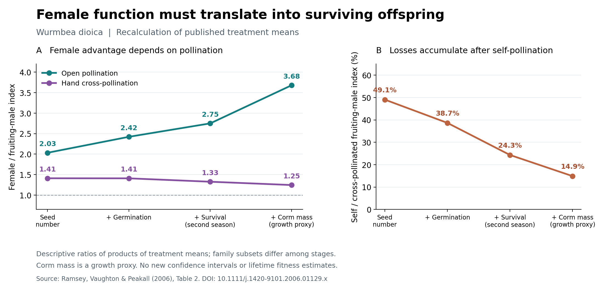

# Wurmbea：雌性機能を持つことと、その機能で子孫を残す利益

**2026-11-14｜既刊原著の公表平均の再計算。** 前回の「雄花のみの個体も両性花を形成できる」から、その雌性機能が繁殖成果につながる条件へ進めた。**原著者が示した現象をSLKの生物学的比較へ接続するもので、新規野外発見やメタ解析ではない。**

## 今回の結果

Ramsey, Vaughton & Peakall (2006), *Journal of Evolutionary Biology* 19:1497–1506, [DOI 10.1111/j.1420-9101.2006.01129.x](https://doi.org/10.1111/j.1420-9101.2006.01129.x), Table 2 の5処理を再計算した。ここで「果実をつける雄型個体」は両性花を持つ個体を指す。1999年の標識個体や2012年に再発現した個体を追跡した実験ではない。

| 雌株／両性花を持つ雄型個体の比 | 自然授粉 | 人工他家授粉 |
|---|---:|---:|
| 種子数 | 2.033 | 1.411 |
| 種子数 × 発芽率 | 2.423 | 1.409 |
| 種子数 × 発芽率 × 2年目生存率 | **2.750** | **1.327** |
| 上記 × 子の球茎重 | 3.680 | 1.246 |

各値は**処理ごとの公表平均の積を比較した記述的な指数**である。家系ごとの積の平均や、実際に一つの母集団から得た生存子孫数ではない。最終行の球茎重は成長の代理量で、生涯適応度ではない。球茎重を使わなくても、自然授粉の比2.750に対して人工他家授粉では1.327となる。

同じ雄型個体群の自家授粉／他家授粉の比は、種子数0.491、発芽を含めると0.387、生存まで0.243、球茎重まで含めると0.149。後者からの `1 − 比 = 0.851` は原著の実験的な累積近交弱勢0.85と対応する。ただし段階ごとの家系構成が異なり、この値を自然下で生殖年齢まで到達する確率とは解釈できない。



## SLKの生物学的な主張への接続

**多機能性を維持する利益は、器官を作れるかだけでなく、その機能がどれだけ有効な子孫を生むかに左右される。** 既存の再発現結果が形成能力を示す一方、今回の比較は送粉・交配と子の成績が繁殖利益を変えることを具体化する。

これにより、同じ機能的葛藤の下でも、可塑的に両性機能を使う状態と性分業が異なる環境で維持され得る、というSLKの問いが明確になる。ただし雄性父性寄与と再発現しなかった場合の反実仮想は未測定であり、「両性機能を残すと総適応度が増える」ことまでは示していない。

近縁 *W. biglandulosa* でも、原著の野外除雄実験は、二型集団の雄型個体で除雄後に種子数が増え、両性集団では同じ差が検出されないことを報告する。これは交配条件への依存を支持する別の例である。この原著は[原著抄録](https://pubmed.ncbi.nlm.nih.gov/16637498/)までの確認に留め、数値は今回の計算へ混ぜていない。

## 解釈を変える限界

- **2006年の供試個体は採集時点で既に両性花を持つ。** 今回の比較は性表現を切り替えた効果そのものではない。
- 自然授粉対人工他家授粉には、野外対温室での授粉、除雄、花粉供給量などの違いも含まれる。対比の全差を自殖率一つの因果効果としない。
- 発芽試験と成長・生存試験の家系数が異なる。生存試験は計57家系・456実生で、自家授粉した19母株中4母株は後続試験に十分な種子を作れなかった。元の家系記録と共分散がないため、新たな信頼区間や有意差は計算していない。
- 原著の他殖率は発芽した実生で測定されている。接合子の他殖率と読み替えたり、種子形成段階を含む累積近交弱勢を重ねて掛けたりしない。

## 原著内の数値と表の算術を区別する

原著抄録・考察の人工他家授粉下の雌株優位「1.4」は、Table 2 の種子数比1.411と対応する。一方、四成分の積の比は1.246であり、本文の逆比 `Mc/Fc = 0.80` と整合する。両者を同じ指標として転記しない。

自然授粉／他家授粉の雄型個体の四成分比は、表から0.296189となるが、公開原著本文の値は0.23 ± 0.07である。小数第1位への丸めだけでは一致しない（丸めだけの許容範囲0.292868–0.299544）。この範囲は統計的信頼区間ではない。原著PDFの描画と家系原票を独立確認できていないため、原著の誤りと断定せず**未解決の原著内不整合**として両方を保持する。主要な2.750／1.327の比較に0.23を代入していない。

## 前回の記載の訂正

1999年の原著者は **Barrett, Case & Peters** であり、旧文書の著者名を訂正した。また二時点の標識表が示すのは、別々の個体で観察された両方向の変化である。「同じ個体が雄→両性→雄と往復した」という三時点の記録として扱う記述を訂正した。14/28などの観測集計は変更していない。

## 再現と出典

主資料は [2006年原著全文の公開テキスト](https://www.academia.edu/55515324/Does_inbreeding_avoidance_maintain_gender_dimorphism_in_Wurmbea_dioica_Colchicaceae_) の Table 2（p.1500）、方法（pp.1499–1501）、Fig.2・結果（p.1502）。書誌と抄録は[出版社記録](https://academic.oup.com/jeb/article-abstract/19/5/1497/7324691)でも確認した。表の事実データを手動転記し、独立した二つの計算で照合した。

```bash
python analysis/analyze_wurmbea_reproductive_return_v2.py --output results/wurmbea_reproductive_return_v2.json
python -m unittest discover -s tests -p 'test_wurmbea*.py' -v
python analysis/plot_wurmbea_reproductive_return_v2.py
```

原表転記：`data/evidence/wurmbea_2006_reproductive_return_source_v2.json`。再計算値：`results/wurmbea_reproductive_return_v2.json`。この追補は生物学的ドラフトに置き、SLKの正準モデルの `Phi`、侵入率、固定率、歴史的起源の推定には置換しない。
